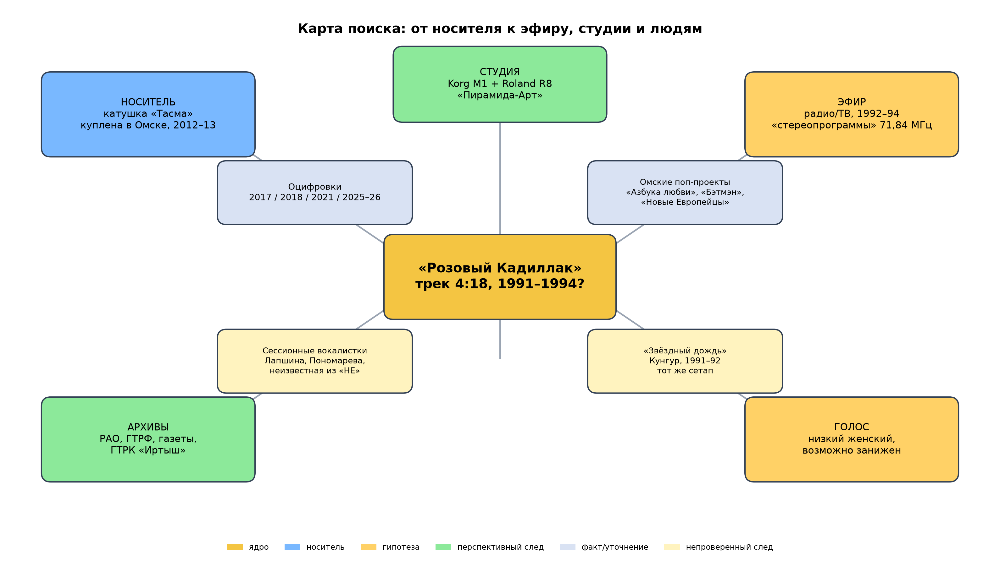

# «Розовый Кадиллак»: полный отчёт о поисках

**Версия:** 11.11.2026  
**Объект:** русскоязычная неопознанная песня «Розовый Кадиллак» (предположительно 1991–1994).  
**Цель:** собрать максимум проверяемой информации, отделить факты от гипотез и фейков, оценить ход поисков и предложить дальнейшие направления.  
**Источники:** экспорт Telegram-чата «Розовый Кадиллак» (8 553 сообщения, 27.07.2024–10.11.2026), полная оцифровка катушки (стороны А/Б, WAV 96 кГц), файл песни, реконструкция минусовки, 470 фотографий, 121 видео, 204 файла, открытые источники и собственный аудиоанализ.

---

## Содержание

1. Исполнительное резюме  
2. Методика и качество данных  
3. Носитель: катушка, владелец, оцифровки  
4. Аудиофорензика: инструменты, темп, вокал, шумы  
5. Хронология поисков  
6. Реестр кандидатов  
7. Ложные следы, фейки и вбросы  
8. Что дали архивы и реестры  
9. Текст, музыка, стиль  
10. География и локальные сцены  
11. Критика поисков: ошибки и слепые зоны  
12. Дальнейшие направления  
13. План ручных действий  
14. Открытые вопросы  
15. Приложения

---

## 1. Исполнительное резюме

«Розовый Кадиллак» — русскоязычная поп-песня с низким женским вокалом, записанная, вероятно, в 1992–1994 годах на Korg M1 и Roland R8. Единственный известный носитель — личная катушка «Тасма», купленная в Омске на рынке в 2012–2013 годах. Катушка не фабричная: это самописец, на который поверх старых записей записан сборник 1988–1994 годов. На катушке есть обрезанные начала песен, разные уровни, бытовые шумы и фрагмент радиопередачи, поэтому запись, вероятно, делалась с эфира или переписывалась с других носителей.

Первый публичный след — 27.03.2017; активные поиски начались в 2023–2024 годах. За два года сообщество проверило не менее 50–60 кандидатов — от Органической Леди и Светланы Разиной до малоизвестных омских и сибирских проектов. Почти все известные певицы ответили отрицательно; часть кандидатов умерла или не выходит на связь. Громкие «солвы» не подтвердились: «Ночной Каприз», «Мисс Непотопляемая», «Леди Джей», магаданская катушка с радио «Карибу», Паша Кайзер, «подтверждение» Леди Тени. РАО и ГТРФ не дали следов, но это отрицательные результаты, а не доказательство отсутствия песни.

Наиболее вероятный сценарий: **локальное студийное демо или единственная запись начинающей/сессионной певицы, прозвучавшая один-два раза в региональном эфире и не имевшая коммерческого релиза.** Наиболее перспективные направления — не перебор известных имён, а омская инфраструктура начала 1990-х: ГТРК «Иртыш» с «стереопрограммами» на 71,84 МГц, студия «Пирамида-Арт» в Омском Доме Радио, местные поп-проекты, сессионные вокалистки, архивы программ передач и местной прессы. Второй по перспективности след — «Звёздный дождь» (Кунгур) с тем же сетапом Korg M1/R8 и похожим вокалом при замедлении.

---

## 2. Методика и качество данных

### 2.1. Что было сделано

- Прочитан экспорт чата: 8 553 сообщения, 168 авторов, 27.07.2024–10.11.2026.
- Прочитан второй экспорт: 838 сообщений, 11.01.2025–16.08.2026 (половина — репосты, но есть уникальные детали).
- Проанализированы длинные аналитические посты, дайджесты, закреп, ветки кандидатов, архивные скриншоты.
- Просмотрены 470 фотографий (контактные листы и отдельные ключевые изображения), 121 видео (выборочно), 204 файла (аудио/документы).
- Проведён собственный аудиоанализ: спектр, темп, тональность, высокочастотные линии, скорость, выделение вокала; `РК 2017.mp3` отдельно проверен только как свидетельство даты.
- Проверены открытые источники: LostMediaWiki, Неолурк, YouTube-комментарии, омские СМИ, Discogs, РАО, ГТРФ, сайты омских групп.
- Сделана попытка независимого поиска: YouTube, комментарии, омские студии, «Пирамида-Арт», «Новые Европейцы», «Звёздный дождь».

Второй чат добавил несколько уникальных пунктов: **РГАФД** как альтернативу ГТРФ, **реестр наследственных дел** (проверка, жива ли певица, при появлении ФИО), кандидатуру **Вики Борщенко** (участница «50/50» 1994, кабацкий репертуар — слабая версия) и обсуждение **«Талисмана»** как возможного названия (маловероятно). Эти пункты учтены в разделах 11–12.

### 2.2. Ограничения

- Чат — не архив: сообщения редактировались и удалялись, ссылки умирали, часть ответов известна только по скриншотам.
- Многие «опровержения» — устные или в личных сообщениях; оригиналы недоступны.
- РАО/ГТРФ неполны; отрицательный результат не равен отсутствию записи.
- Визуальные материалы в основном дублируют текст; часть скриншотов нечитаема.
- Автор отчёта не имеет доступа к закрытым архивам и не может гарантировать дословное прочтение каждого сообщения; ключевые ветки и финальные обсуждения изучены.

### 2.3. Принципы классификации

- **Установленный факт** — подтверждён носителем, документом или несколькими независимыми источниками.
- **Наблюдение** — результат анализа аудио/изображений, который может иметь альтернативные объяснения.
- **Гипотеза** — версия, не подтверждённая независимо.
- **Отрицательный результат** — кандидат ответил отрицательно или проверка показала несовпадение.
- **Фейк** — доказано, что источник вымышлен или запись подделана.

---

## 3. Носитель: катушка, владелец, оцифровки

### 3.1. Катушка

- Тип: «Тасма», 525 м, бытовая, не фабричный сборник.
- Куплена: Омск, блошиный рынок, 2012–2013 годы, вместе с ~10 другими катушками.
- Владелец: Павел Дербенёв (он сам вышел на связь в январе 2026 года).
- Надписи на конверте: синим — «П.п. „Выборочный-4“», фиолетовым — «1. Лётние грёзы 2. 3/9 царство ’89» и «1 Добрынин 2 Истомин 89». Вероятно, относятся к предыдущим записям, затёртым новым сборником.
- На фото видны два разных слоя подписей (разные чернила/почерки). Часть подписей сделана младшим братом владельца после покупки, часть, вероятно, прежним владельцем. «П.п.» может означать «первая половина», «предыдущая песня» или инициалы; однозначно не читается. Трекиста текущего сборника на конверте нет — его восстанавливали по слуху.

### 3.2. Оцифровки

| Год | Как | Особенности |
|---|---|---|
| 27.03.2017 | Диктофон телефона | Первый публичный след; файл 4:29, запись с микрофона — не эталон скорости/АЧХ. |
| 2018 | Магнитофон «Астра 110» | Первая «нормальная» оцифровка; LostMediaWiki ошибочно называет 27.03.2018 первой публикацией. |
| 2021 | Неизвестно | Отдельная оцифровка в паблике «Хиты с магнитной ленты»; происхождение до конца не ясно. |
| 2025 | «Союз 111» | Полная оцифровка катушки. |
| 2026 | Audacity, WAV 32-bit float, 96 кГц | Повторная оцифровка; используется для анализа. |

### 3.3. Что это значит

Катушка — личный сборник, а не релиз. Это объясняет:

- отсутствие треклиста в интернете;
- странный порядок песен;
- обрезанные начала;
- разные уровни и шумы;
- наличие песен, которые не могли выйти одновременно.

«Сборник 1994 года» — условное название. Сама катушка не могла быть записана раньше 1994 года (в треклисте есть песни 1994 года), но «Розовый Кадиллак» мог быть создан в 1991–1993 годах и лишь позже попасть в сборник.

Первый пост: `https://vk.com/wall-105001236_10340`. Он собрал 10 лайков, 15 комментариев и 1 репост. В нём был трехсекундный аудиофрагмент и шесть изображений (сейчас не загружаются). Комментарии — оффтоп Сандры Сиренко, без идентификации. Это отрицательный результат: первый пост не дал зацепок. Если шесть изображений когда-нибудь восстановятся из кэша ВК, они могут содержать треклист или фото катушки.

---

## 4. Аудиофорензика

### 4.1. Инструменты

- **Korg M1** — основной синтезатор. Патчи: Piano 8’, Softstring, Symphonic (без Saw), Ooh/Aah, Soft Horns, Pick Bass.
- **Roland R8/R5** — драм-машина; патч SN-R8-09.
- **Atari ST / DOS-секвенсор** — вероятный способ секвенсирования.
- **Строй:** A440; инструментал играется на заводских пресетах M1 без подстройки.
- **Темп:** ~123–125 BPM, 4/4; синкопы в клавишных.

### 4.2. Структура

- Резкое вступление (возможно, потеряны первые такты).
- 4 полных квадрата без вокала.
- Куплет — припев.
- Второй куплет — припев.
- Инструментальный проигрыш.
- Припев — финал с фейдом.
- Аплодиментов нет; это не концерт.

### 4.3. Вокал

- Низкий женский, возможно контральто.
- Три гипотезы: естественный тембр; искусственное занижение (вокал поверх ускоренной фонограммы, затем замедление); перезапись/детонация.
- Ни одна не доказана.
- Практический вывод: перед сравнением кандидатов нужно калибровать скорость и тональность.

### 4.4. Линия 15,7 кГц

В WAV-оцифровке присутствует устойчивый узкополосный сигнал:

- в WAV — около **15,79 кГц**;
- в старом MP3 — около **15,72 кГц** (пик 15 716 Гц, рядом 15 734 Гц);
- сигнал есть на обеих сторонах, в паузах и в музыке;
- пропадает ближе к концу стороны Б.

Интерпретация:

- это **не** пилот FM 19 кГц;
- это **не** обязательно 31,25 кГц советского стерео (хотя гармоника 15,625 кГц возможна);
- по частоте ближе к строковой частоте CRT (15,625/15,734 кГц) или половине строчной частоты VGA (31,47 кГц);
- наличие сигнала в паузах — сильный аргумент против «пилот радиостанции»;
- вероятнее всего, это местная наводка от телевизора/монитора, а не маркер эфира.

Это уточнение важно: линия не помогает доказать радиоэфир и не указывает на станцию. Она лишь говорит, что рядом с магнитофоном был CRT-прибор. По файлу 2017 года нельзя судить, была ли линия в оригинале: микрофон дешевого телефона срезал высокие частоты. Вывод о линии сделан только по поздним WAV/MP3.

### 4.5. Скорость

Старый MP3 и WAV-оцифровка 2026 года отличаются по скорости, но главное не это. После калибровки по шести CD-референсам (см. `11_Калибровка_скорости`) выяснилось, что **катушка не имеет одной постоянной скорости**:

- медленный префикс (Распутина, Киркоров) — примерно **+1,1–1,3%**;
- быстрый остров (Буланова, Аллегрова, «Кадиллак») — примерно **+5–6%**;
- медленный суффикс (Миражи, Кай Метов) — примерно **+1,5–2%**;
- сторона A (Агутин) — практически верная, около **−0,8%**.

При этом Аллегрова на катушке — не официальная версия 1994 года, а ранняя концертная 1992–1993 с другой аранжировкой.

Для «Кадиллака» лучшая оценка — **+5,5%**. Это почти **0,93 полутона**, а не 5–17 центов. Прежние 123–125 BPM — это уже ускоренная катушка; после коррекции получается около **118,5 BPM**. Поэтому все сравнения нужно делать на `Розовый_Кадиллак_CD-speed_r1055.mp3` (playback rate 0,948, растяжение 1,055).

**Файл 2017 года** (`РК 2017.mp3`: 4:29, 44,1 кГц, стерео) — не эталон. Он записан на диктофон дешевого телефона через микрофон, с неизвестного магнитофона; его скорость, АЧХ и шумы недостоверны. Разница в скорости и отсутствие линии 15,7 кГц ничего не доказывают: телефон мог играть медленнее и срезать высокие частоты. Файл 2017 года полезен только как свидетельство даты/существования песни. Для калибровки скорости и анализа линии нужны поздние WAV/MP3 и официальные фонограммы.

### 4.6. Щелчки в начале

На 00:05, 00:13, 00:15 слышны щелчки, похожие на закрывание двери/багажника. Версии:

- дефект ленты/склейка;
- звуки из видеоклипа;
- бытовые шумы комнаты.

Прямых доказательств нет. Если это клип, песня могла быть телевизионной/видеоработой; если лента — это просто дефект.

### 4.7. Радиозвонок

На стороне А, 37:58, слышен женский голос: «Привет… слушаю ваше радио». Это может быть звонок в студию или зачитанное письмо. Доказывает, что часть катушки — радиозапись, но не обязательно «Розовый Кадиллак».

---

## 5. Хронология поисков

### 5.1. 2012–2023: до чата

- 2012–2013: покупка катушки в Омске.
- 27.03.2017: первый публичный след — комментарий Павла Дербенева в ХСМЛ; запись с телефона.
- 2018: оцифровка «Астра 110»; LostMediaWiki ошибочно указывает 27.03.2018 как первую публикацию.
- 2021: отдельная оцифровка в паблике.
- 05.03.2023: «МагнитИздат» выкладывает песню на YouTube.
- 2023–2024: песня становится известной в lostwave-сообществе.

### 5.2. 2024: создание чата и первые версии

- 27.07.2024: создана тема «Розовый Кадиллак».
- 28.07.2024: первое описание происхождения (МагнитИздат, ВК, катушка).
- 13.08.2024: найден первый источник 2017 года (тема ВК, сообщение №1436).
- 17.09.2024: версия «Органическая Леди» (95%), ответа нет.
- 19–20.10.2024: щелчки, версия клипа/ТВ.
- 28.10.2024: найден продюсер Органической Леди.
- 02–03.11.2024: проверена Ольга Восконьян, ответ отрицательный.
- 05–06.11.2024: версия «Невский Проспект», мужской вокал.
- 10–11.11.2024: найдена вторая запись ВК; владелец выходит на связь.
- 13.11.2024: обсуждение треклиста; версия самописного сборника.
- 14.11.2024: решение сделать страницу на Lostwave’s Finest.

### 5.3. 2025: систематизация, «солвы» и разочарования

- 22.01.2025: «МагнитИздат» сообщает о версии «Ночной Каприз».
- 23–25.01.2025: Юрий Соколов читает, не отвечает, удаляет переписку.
- 03.02.2025: версия сборника «Не хлопай ушами — лети на звук».
- 28.02.2025: выясняется, что это вброс; «Ночной Каприз» — фейк.
- 27.03.2025: большой брифинг; катушка 1992–1994, куплена в Омске; в РАО — «Кадиллак» Светашова.
- 05.04.2025: полная оцифровка катушки; треклист; проверка Инны Смирновой.
- 12.04.2025: полный треклист; дуэт «Ночной Каприз» опровергает.
- 13–17.04.2025: история с «Леди Джей» (галлюцинация ИИ); проверка Елены Зосимовой.
- 17.04.2025: группа «Леди» (Омск) опровергнута; 19.04 — «Каролина».
- 22.04.2025: версия заниженной скорости; акапелла и минус.
- 10–11.05.2025: «Двое» и Юлия Мирошниченко.
- 13.05.2025: слух о Игоре Крутом (не подтверждён).
- 16.05.2025: «Кадиллак» в РАО — ASIMOYLEN, не тот.
- 17.06.2025: Мария Кац; 01.07 — Наталья Гулькина.
- 28.07.2025: Наталья Новикова; 10–11.08 — Леди Тень.
- 14.09.2025: Юлия Мирошниченко (Julia Freitor), ответа нет.
- 26–29.09.2025: Анна Резникова, сходства нет.
- 30.10.2025: Олег Малышков (Радио-3), песню не знает.
- 01.11.2025: гипотеза радио/ТВ; Korg M1/R8; A440/BPM 125.
- 05.11.2025: Ирина Турган, «Электронная индустрия»/Scream.
- 11.11.2025: Марина Волкова («Барби») опровергает.
- 16.11.2025: фейковый релиз «Диана Лайт» на Discogs.
- 20.11.2025: Алексей Вишня не знает.

### 5.4. 2026: омский след и череда фейков

- 02.01.2026: «магаданская» катушка от Алексея Жоги; радио «Карибу», 2002.
- 03–12.01.2026: Julia Star (Ирина Вильхельм) найдена, 12.01 опровергла.
- 04–05.01.2026: «Душечка»/«Колдунья Алёнка»/Ната; Наталья Журкина.
- 05–08.01.2026: Ирина Воронцова; Сергей Мудров говорит, что её нет в живых.
- 11–12.01.2026: Марина Ерехинская («Ди Джей») опровергает.
- 13–14.01.2026: запрос в ГТРФ; 21.01 — ответ «ничего нет».
- 19–20.01.2026: «магаданская» запись — та же оцифровка; фейк.
- 23.01.2026: Павел Дербенёв выходит на связь; история покупки и оцифровок.
- 25.01.2026: итог: «единственная точная инфа — синты».
- 02.02.2026: найден радиозвонок на стороне А.
- 03.02.2026: дайджест: часть песен с радио; WAV-переоцифровка.
- 07.02.2026: WAV 96 кГц; линия 15 кГц; обсуждение.
- 08.02.2026: print-through/эхо.
- 13.02.2026: шуточная «биография» Мисс Непотопляемой.
- 21.02.2026: Галина Журавлёва опровергает.
- 24.02.2026: Юлия Измайлова; «Орхидея».
- 02.03.2026: ИИ-фейк «Розовый Кадиллак» на YouTube.
- 04.03.2026: Светлана Рерих — «не моя».
- 05.03.2026: Наталья Куницына — не она.
- 30.03.2026: спад активности.
- 02.04.2026: отказ от версии ИИ; физическая катушка.
- 09.04.2026: Елена Забияко — не она.
- 10–11.04.2026: Юлия Рязанова — не она.
- 16.04.2026: омский «Бэтмэн», трансляции 6 и 20.12.1992.
- 22.04.2026: Виталий Яковенко.
- 04.05.2026: Виктория Вита/Макарская.
- 14.05.2026: Наталья Симонова.
- 22.05.2026: Анна Кипяткова (Pep-See).
- 25.05.2026: Анжелина Петросова.
- 28.05.2026: спор 3/4 vs 4/4.
- 24.06.2026: версия «ОП сам сделал» отвергнута.
- 25.06.2026: Ретро FM и «Серебряный дождь» не ответили.
- 30.06.2026: гипотеза 71,84 МГц / ГТРК «Иртыш».
- 11.07.2026: Елена Савельева, газета 1995.
- 20.07.2026: контакт в ГТРК.
- 24.07.2026: «Блонди Бэнд» (Рига), Дятлова опровергает.
- 25.07.2026: отказ от балтийской версии.
- 14.08.2026: «Паша Кайзер» — фейк.
- 16.08.2026: дайджест; No Changes готовит ролик.
- 23.08.2026: Владимир Погодаев (ГТРК «Иртыш») ответил.
- 25.08.2026: годы песен на катушке 1988–1994.
- 26.08.2026: «Леди Тень» — скандал, «мистификатор».
- 27.08.2026: Погодаев: «пока глухо».
- 01.09.2026: «Актиний» (Екатеринбург).
- 09.09.2026: Надежда Антончик.
- 13.09.2026: бабушка слышала РК по омскому радио.
- 20.09.2026: повторное «подтверждение» Леди Тени.
- 05.10.2026: Светлана Бурова.
- 12.10.2026: РАО по Буровой; Kadillac/Kadillak.
- 17.10.2026: Random Unit — не то.
- 19.10.2026: «Вера — Адьё»/Федоткин.
- 20.10.2026: «Белые машины», M1.
- 24–25.10.2026: DVD Project / Little Dream.
- 28.10.2026: конкурс/демо/дочь топ-менеджера.
- 31.10.2026: в чате сравнили первую версию 2017 года; она не годится для анализа линии/скорости (запись с микрофона телефона).
- 01.11.2026: шуточный «SOLVED»; качество лучше AM.
- 02.11.2026: Калина Найс; Наталья Никифорова; «ТЕМП» 1992.
- 03.11.2026: Наталия Бурдыгина; «Звёздный дождь».
- 05.11.2026: Игорь Чухнин не помнит, обещал спросить.
- 06.11.2026: Елена Савельева; «Золотой микрофон»; Любовь Трухина.
- 07.11.2026: Юлия Измайлова; полные магнитоальбомы.
- 09.11.2026: «Пирамида-Арт»/Белоусов.
- 10.11.2026: Белоусов не в сети; ЕГРЮЛ; 15,6 кГц.

---

## 6. Реестр кандидатов

### 6.1. Исключены

(Полная таблица — в файле `03_Подробный_отчёт.md`, раздел 6.1. Здесь перечислены ключевые.)

Органическая Леди, Невский Проспект, Инна Смирнова, Ольга Восконьян, Ольга Лиснянская, Наталья Корецкая, Ночной Каприз, Лена Зосимова, Каролина, Атлантида, Анна Шторм, Мария Кац, Наталья Гулькина, Леди Тень, Леди в чёрном, Светлана Разина, Наталья Новикова, Барби, Империя, Марина Ерехинская, Julia Star, Светлана Троцкая, Галина Журавлёва, Светлана Рерих, Наталья Куницына, Елена Забияко, Юлия Рязанова, Элла Бородянская, Ольга Лагутенкова, Наталия Бурдыгина, Любовь Трухина, Ирина Турган, Марина Кирсанова, Кар-Мэн/Лемох.

### 6.2. Под вопросом

Наталья Журкина (Прокофьева), Ирина Воронцова, Надежда Бурова, Наталья Скурыхина (Магма), Юлия Мирошниченко, Наталья Симонова, Виктория Вита/Макарская, Надежда Антончик, Калина Найс, Юлия Измайлова, «Звёздный дождь», «Блонди Бэнд», «Душечка»/Ната, Елена Савельева, Наталья Никифорова, «Вера»/Федоткин, «Талисман»/Юзеева, «Little Dream»/Зайцева, Вика Борщенко (слабая версия из второго чата), Люся Розанова (вопрос по почте, ответа нет).

### 6.3. Непроверенные локальные участницы

Это важнейшая группа, которая почти не отработана:

- вторая вокалистка «Азбуки любви» (Омск, 1993–1995);
- Юлия Лапшина (бэк-вокал «Бэтмэна», 1995);
- участницы «Мамочки», «Нежного возраста», «Талисмана»;
- сессионные певицы студии «Пирамида-Арт»;
- участницы омских ДК/конкурсов 1991–1995.

«Новые Европейцы» (вокалистка 1993) сняты с приоритета: по альбомам Invasion (1992) и Rock Mit Uns (1995) группа играла драйвовый рок с электрогитарами, а не синти-поп/диско. М. Пономарева («Парадный вход») — низкий приоритет: альбомы группы 1994–1995 ещё тяжелее, как сессионная вокалистка для РК маловероятна.

---

## 7. Ложные следы, фейки и вбросы

| Фейк | Как возник | Урок |
|---|---|---|
| Мисс Непотопляемая | Вымышленная певица с «биографией» | Красивая история ≠ документ |
| Ночной Каприз | Комментатор придумал группу и сборник | Проверять источник комментария |
| Леди Джей | Галлюцинация DeepSeek | ИИ не источник |
| Диана Лайт | Фальшивый релиз на Discogs | Проверять метаданные |
| Магадан/Карибу | Вторая катушка — копия | Сравнивать помехи и детонацию |
| Паша Кайзер | Мужской вокал, другой сетап | Проверять тембр и инструменты |
| Леди Тень | Ей отправили её же песни | Проверять, что именно отправлено |
| Тирас | Утверждение без доказательств | Не принимать на веру |
| «Не хлопай ушами» | Вымышленный сборник | Проверять треклист |
| Светлана Бурова | Комментарий без источника | Проверять биографию |

---

## 8. Что дали архивы и реестры

### 8.1. РАО

- «Кадиллак» Светашова — другой трек (ASIMOYLEN).
- «Розовый Кадиллак»/«Pink Cadillac» — релевантных записей нет.
- Отсутствие регистрации не доказывает, что песня не звучала: до 1993 года регистрация была необязательной.

### 8.2. ГТРФ

- Ответ: фонограммы «Розовый Кадиллак» нет.
- Это важный отрицательный результат, но не доказательство: региональные эфиры могли не попасть в фонд.

### 8.3. Радио «Карибу» (Магадан)

- Диджеи дали противоречивые ответы.
- Сравнение помех показало, что запись — та же оцифровка, повторно записанная на ленту.
- Версия закрыта как фейк.

### 8.4. ГТРК «Иртыш» (Омск)

- На УКВ была частота 71,84 МГц для «стереопрограмм из Омска».
- Транслировали целые альбомы (например, «Бэтмэн» 6 и 20.12.1992).
- Владимир Погодаев (ветеран, главный режиссёр до 2023) ответил, но по делу «глухо»; он опросил нескольких знакомых музредов и Алексея Гализдру — никто не знает.
- **Официального запроса в архив ГТРК не было** — это не закрытая, а непроверенная дверь.
- Архив и музыкальные редакторы 1991–1994 — главное направление.

### 8.5. «Пирамида-Арт» (Омск)

- Студия/лейбл в Омском Доме Радио, рядом с ГТРК.
- Руководитель — Иван Белоусов; работали Олег/Игорь Фауст, Тимур Тимбаев, Алексей Гализдра («Мамочка»).
- Записывали Картавцева, «Бэтмэн», «Новые Европейцы», «Воланд».
- Белоусов не вышел на связь; ЕГРЮЛ: ликвидация, деятельность могла прекратиться до 2000.
- Перспективный след, не подтверждён. Гализдру уже спрашивали о песне, но не о сессионных певицах — это отдельный вопрос; повторно дергать его не стоит без нового конкретного повода.

### 8.6. «Звёздный дождь» (Кунгур)

- Группа 1991–1992, студия Павла Фадеева («Антикварный магазин»).
- Участники: Сергей Иванов, Наталья Некрасова, Лилия Таламина, Игорь Чухнин.
- При замедлении голос похож; сетап M1/R8 совпадает.
- Чухнин не помнит, обещал спросить.
- Второй по перспективности музыкальный след.

---

## 9. Текст, музыка, стиль

### 9.1. Текст (реконструкция)

> Стремительный полёт, ведь жизнь своё берёт  
> И ты не успеваешь ничего.  
> Рискни, остановись, с небес своих спустись  
> И среди всех узнаешь ты его.  
> Он хочет быть с тобой всегда,  
> Но ты говоришь «пора»,  
> А вдруг это дорога в никуда?  
>  
> Розовый кадиллак тьму ночи вдаль разгоняет,  
> Розовый кадиллак унесёт далеко меня (меня),  
> Розовый кадиллак — я со скоростью играю,  
> Розовый кадиллак — это мой талисман.  
>  
> Неведомо куда уносятся года,  
> И в суете живёшь ты день за днём.  
> А жизнь так коротка, и вроде цель близка,  
> Но только это всё — игра с огнём.  
> Но позади сомнения, и ты спешишь туда,  
> Где скорость, ветра свист и риск всегда.

Спорные места: «тьму ночи вдаль разгоняет» / «мимо мчит он разгоняясь» / «словно чита разгоняет»; «где скорость, ветра свист и риск всегда» / «где скорость ветра, здесь ты не всегда». Текст простой, с шероховатой рифмовкой; вероятно, написан непрофессионалом или поэтом-любителем.

### 9.2. Музыка

- Жанр: поп/евробит с элементами итало-диско и раннего рейва.
- Форма: куплет — припев, повтор, инструментальный проигрыш, финал.
- Гармония: куплет C#m–A, вступление A maj (по одной из реконструкций).
- Аранжировка: фортепианный рифф, синтетические струнные, хор, бас, драм-машина.
- Мастеринг: перегруз, детонация, «грязный» верх; вероятно, запись с кассеты/радио, а не с оригинала.

### 9.3. Что это говорит о происхождении

Профессиональная аранжировка + слабый мастеринг + отсутствие релиза = типичный студийный демо-трек или запись для радио/конкурса. Это не домашняя самодеятельность, но и не большой релиз.

---

## 10. География и локальные сцены

### 10.1. Омск

- Катушка куплена в Омске.
- В треклисте много песен, которые могли звучать на омском радио.
- ГТРК «Иртыш» — стереопрограммы 71,84 МГц.
- «Пирамида-Арт» — студия в Омском Доме Радио.
- Омские поп-проекты: «Нежный возраст», «Азбука любви», «Бэтмэн», «Парадный вход», «Воланд». «Новые Европейцы» — низкий приоритет по музыкальному стилю.
- Сессионные вокалистки: Юлия Лапшина; «Новые Европейцы» и М. Пономарева сняты с приоритета по музыкальному стилю.

### 10.2. Кунгур/Пермь

- «Звёздный дождь», студия «Антикварного магазина».
- Тот же сетап M1/R8, похожий вокал при замедлении.
- Географически далеко от Омска, но катушка могла приехать.

### 10.3. Другие регионы

- Беларусь, Украина, Казахстан, Прибалтика, ПМР.
- Проверялись точечно; системного поиска не было.
- «Блонди Бэнд» (Рига) — опровергнута.
- «Тирас» (ПМР) — вероятный фейк.
- Белорусский/украинский след остаётся открытым.

---

## 11. Критика поисков: ошибки и слепые зоны

### 11.1. Якорение на известных певицах

Большая часть усилий ушла на проверку «звёзд» и полузвёзд. Это дало отрицательные результаты, но не приблизило к локальной сессионной певице.

### 11.2. Слабая форензика

- Не была построена единая карта треков, шумов, обрывов.
- Скорость не калибровалась.
- 15 кГц интерпретировали по-разному.
- Не сравнивали спектры/детонацию всех оцифровок.
- Не искали тот же минус/пресеты в других записях.

### 11.3. ИИ-загрязнение

- «Леди Джей», «Диана Лайт», фальшивые сборники.
- Нейросети генерировали «факты», которые попадали в чат.
- Нужен фильтр: ИИ-ответ не является источником.

### 11.4. Отсутствие базы

- 8,5 тыс. сообщений, повторы, потерянные ссылки.
- Закреп отставал от статуса.
- Нет единой таблицы кандидатов с датами и доказательствами.

### 11.5. Массовые обращения

- Спам по музыкантам и блогерам давал мало.
- Точные запросы в архивы/студии эффективнее.
- Некоторые кандидаты игнорировали из-за формы обращения.

### 11.6. Нет критериев «солва»

- Что считать доказательством?
- Ответ кандидата? Скриншот? Сравнение голоса?
- Без критериев каждый «солв» был преждевременным.

### 11.7. Недооценка локальной истории

- Омск 1991–1995 — это студии, ДК, конкурсы, радио, телевидение, сессионные музыканты.
- Поиск «звёзд» прошёл мимо этого слоя.

### 11.8. Плохая работа с текстом

- Текст не проверен по поэтическим архивам, газетам, сборникам, конкурсным заявкам.
- Не искали автора строк.

### 11.9. Нет проверки «Pink Cadillac»

- Песня могла быть русской переработкой западного хита.
- Это направление не отработано.

### 11.10. Нет версии «певица не хочет говорить»

- Многие отказы могли быть не «не она», а «не хочу вспоминать».
- Нужны деликатные обращения через посредников.

### 11.11. Файл 2017 года — не эталон

- Записан на диктофон дешевого телефона через микрофон, с неизвестного магнитофона; скорость, АЧХ и шумы недостоверны.
- Отсутствие линии 15,7 кГц ничего не доказывает: микрофон срезал высокие частоты.
- Использовать только как свидетельство даты/существования песни; для калибровки — поздние WAV/MP3 и официальные треки.

### 11.12. Не использовали локальных людей и незакрытые архивы

- В чате есть минимум двое, кто может физически сходить в омские библиотеки/архивы, но это почти не использовано.
- В ГТРК «Иртыш» официально не обращались.
- РГАФД и реестр наследственных дел не проверялись.
- «П.п. „Выборочный-4“» не расшифровано и не связано с предыдущими записями.

---

## 12. Дальнейшие направления

*Детальная версия карты — в файле `graph_rk.png`.*

### 12.1. Форензика и аудио

1. **Калибровка скорости** по известным трекам (Аллегрова, Агутин, Киркоров, Буланова) и по линии 15,7 кГц; создать единый эталон. Файл 2017 года для калибровки не использовать: это запись с микрофона дешевого телефона.
2. **Выделение вокала** (Demucs) и сравнение тембра с кандидатами через speaker embeddings; слепые тесты.
3. **Поиск того же минуса** в других записях: chroma/DTW по корпусу омских/сибирских поп-записей.
4. **Анализ 15,7 кГц**: амплитуда, фаза, пропадание; определить, CRT это или дефект ленты. Файл 2017 года для этого не использовать — телефон срезал ВЧ.
5. **Анализ щелчков** в начале: сравнить с видеоклипами/ТВ-заставками.
6. **Поиск пресетов M1/R8** в других треках; определить студию по «почерку» аранжировки.
7. **Разобрать 93-МБ оцифровку** «Белый танец / Подойди / Я и ты / Тебе не запретить»: мужской вокал, но тот же круг коллекционера/студии; проверить инструменты и шумовой профиль.

### 12.2. Омская инфраструктура

1. **ГТРК «Иртыш»**: официальный запрос в архив, музыкальные редакторы 1991–1994, программы передач, фонд, Владимир Погодаев. Он уже опросил знакомых музредов и Алексея Гализдру — но не архив.
2. **«Пирамида-Арт»**: Иван Белоусов, Олег/Игорь Фауст, Тимур Тимбаев, Андрей Картавцев, Алексей Гализдра, «Азбука любви», «Бэтмэн», «Новые Европейцы».
3. **Омский Дом Радио**: студии, звукорежиссёры, архивы.
4. **Омское телевидение**: 12 канал, «Зодиак», «Дебют», «ВКО», музыкальные передачи.
5. **Омские ДК и конкурсы**: «Утренняя звезда», «Музыкальный кафедрал», «Ялта», местные смотры.
6. **Сессионные вокалистки**: Юлия Лапшина. «Новые Европейцы» и М. Пономарева («Парадный вход») — низкий приоритет: стиль групп не совпадает с РК.

### 12.3. Архивы и пресса

1. **«Омская правда»**, «Вечерний Омск», «Молодой сибиряк», «TV 11 плюс», «Четверг» за 1991–1995.
2. **Программы передач** радио и ТВ: искать «Розовый кадиллак», «Кадиллак», «Пирамида-Арт», «стереопрограммы».
3. **ГТРФ**, РАО, ВААП, РП-Юнион, **РГАФД**, украинский/белорусский/казахстанский реестры.
4. **Омская библиотека им. Пушкина**, Исторический архив Омской области.
5. **Газетные OCR-архивы**: искать по строкам текста, а не только по названию.
6. **Реестр наследственных дел** — если появится ФИО, проверить, жива ли певица.

### 12.4. Люди и сети

1. **Музыканты омских групп**: Картавцев (писали 09.2025, ответа нет), Тимбаев, Фауст, Немизанский, Кутейников, Магонов, Алыпов, Лапшина, Пономарева.
2. **Радио/ТВ-люди**: Малышков, Погодаев, бывшие редакторы ГТРК.
3. **Журналисты/краеведы**: «Вечерний Омск», «Омская правда», «Трамплин», «12 канал».
4. **Семья/наследники** умерших кандидатов: Журкина, Воронцова, Петросова, Лагутенкова.
5. **Коллекционеры катушек**: искать другие копии сборника, особенно «Выборочный-4».
6. **Двое локальных участников** — Павел Зиновьев и вторая участница из Омска (в этом топике не отмечалась). Распределить между ними подшивки, программы передач и архив ГТРК, чтобы не дублировать.

### 12.5. Международные направления

1. **Беларусь**: местные радио/ТВ 1992–1994, минские студии.
2. **Украина**: Луганск, Киев, Харьков; «История О» проверена, но не все.
3. **Казахстан**: русскоязычная эстрада, омские связи.
4. **Прибалтика**: «Блонди Бэнд» проверена, но не все.
5. **ПМР/Молдова**: «Тирас» — вероятный фейк, но стоит проверить местные архивы.

### 12.6. Публикация и краудсорсинг

1. **Один точный материал** для омских СМИ/краеведов: история катушки, аудио, факты, просьба помочь.
2. **No Changes** и другие lostwave-блогеры: ролик с хронологией.
3. **Lostwaves Finest / r/lostwave / WatZatSong**: международная аудитория.
4. **Не спамить**, а точечно обращаться к людям, которые могли знать.

---

## 13. План ручных действий

Если автоматические/сетевые действия недоступны, вот что можно сделать вручную:

1. **Позвонить/написать в ГТРК «Иртыш»** (Омск): попросить архив музыкальных программ 1991–1994, контакт музыкального редактора, программы передач.
2. **Связаться с Иваном Белоусовым** («Пирамида-Арт») через соцсети/телефон; попросить список сессионных певиц и проектов 1992–1995.
3. **Посетить Омскую библиотеку им. Пушкина** и Исторический архив: просмотреть подшивки «Омской правды», «Вечернего Омска», «Молодого сибиряка» за 1991–1995.
4. **Запросить ГТРФ** официальным письмом с точным описанием трека и датами; указать, что нужен поиск по фонограммам 1991–1994. Параллельно — **РГАФД**.
5. **Проверить РАО/ВААП** по автору/названию; запросить письменный ответ. При появлении ФИО — **реестр наследственных дел**.
6. **Официально запросить архив ГТРК «Иртыш»** — не только через Погодаева, но и письмом/звонком в архив.
7. **Найти родственников/коллег** Натальи Журкиной, Ирины Воронцовой, Анжелины Петросовой; деликатно спросить о записях.
8. **Опросить омских музыкантов**: Картавцев — уже писали 09.2025, ответа нет; Тимбаев, Фауст, Немизанский, Кутейников, Магонов, Алыпов, Лапшина, Пономарева, Гализдра.
9. **Разместить объявление** в омских группах/СМИ с аудио и просьбой откликнуться.
10. **Сделать качественную реконструкцию** (минус + вокал) и выложить для сравнения.
11. **Вести единую таблицу** кандидатов, статусов, доказательств и ссылок.

---

## 14. Открытые вопросы

1. Кто исполнительница?
2. Кто автор музыки и слов?
3. Как называется песня на самом деле?
4. Где и когда она записана?
5. С какого эфира/носителя попала на катушку?
6. Полная ли это версия?
7. Была ли песня издана?
8. Почему она не оставила следов?
9. Не является ли низкий голос результатом замедления?
10. Не является ли песня русской переработкой западного хита?
11. Не является ли она демо для конкурса/радио?
12. Не является ли певица сессионной/бэк-вокалисткой?
13. Не является ли катушка копией более ранней записи?
14. Кто такой «Выборочный-4» и что это за сборник?
15. Почему линия 15,7 кГц пропадает в конце стороны Б?

---

## 15. Приложения

### Приложение A. Ключевые ссылки

- YouTube-оригинал: https://www.youtube.com/watch?v=ozMJv0xX3wA
- LostMediaWiki: https://lostmediawiki.ru/wiki/Розовый_Кадиллак_(неопознанная_песня,_1991-1994)
- Неолурк: https://neolurk.org/wiki/Розовый_Кадиллак
- Первый пост 27.03.2017: https://vk.com/wall-105001236_10340
- ВК-тема первого источника: https://vk.com/topic-105001236_33698165?post=1436
- «Хиты с магнитной ленты»: https://vk.com/wall-105001236_28054
- ГТРФ: https://gtrf.ru/sales/index
- РАО: https://rao.ru/information/reestry/
- Омская библиотека: https://elib.omsklib.ru/
- «Вечерний Омск»: https://omskgazzeta.ru/
- «Пирамида-Арт» (Discogs): https://www.discogs.com/ru/label/2925131
- VCFM Омск: https://vcfm.ru/vc/Cities/omsk.htm
- «Новые Европейцы», биография Евгения Шимпфа: https://jsteeler.ru/music/new-europeans (архив: http://web.archive.org/web/20240808144810/https://jsteeler.ru/music/new-europeans)
- «Молодой Сибиряк», 04.09.1993: https://grob-hroniki.org/article/1993/art_1993-09-04a.html (архив: http://web.archive.org/web/20260519085729/https://grob-hroniki.org/article/1993/art_1993-09-04a.html)
- «Новые Европейцы» (Википедия, вторичный пересказ): https://ru.wikipedia.org/wiki/Новые_Европейцы_(группа)
- «Звёздный дождь»: https://www.youtube.com/watch?v=4BrELkrX_yM
- РГАФД: http://ргафд.рф (с 2024 в составе РГАКФФД; читальный зал: zalfono@rgakffd.ru)
- Реестр наследственных дел: https://notariat.ru/ru-ru/help/probate-cases/
- Второй экспорт: `E:\PinkCadillac\ChatExport_2026-11-11 (1)`

### Приложение B. Ключевые сообщения (id)

- 65053 — закреп/статус.
- 66195 — первое описание происхождения.
- 71383 — первый источник 2017.
- 115213 — брифинг 27.03.2025.
- 117274 — треклист.
- 157361 — дайджест 02–04.01.2026.
- 159130 — дайджест 05–11.01.2026.
- 162282 — дайджест 12–18.01.2026.
- 165528 — дайджест 19–26.01.2026.
- 167059 — дайджест 03.02.2026.
- 202494 — дайджест 16.08.2026.
- 206077 — Погодаев.
- 206815 — «будем решать загадку».
- 207055 — «мистификатор».
- 219052 — «Звёздный дождь».
- 219765 — Юлия Измайлова.
- 220043 — «Пирамида-Арт»/Белоусов.
- 220064 — итоговый список фактов.

### Приложение C. Сокращения

- **РК** — «Розовый Кадиллак».
- **МБО** — «Мой блуждающий огонь» (Наталья Яблонская/Верич).
- **ХСМЛ** — «Хиты с магнитной ленты».
- **ГТРФ** — Государственный телерадиофонд.
- **РАО** — Российское авторское общество.
- **ГТРК** — государственная телерадиокомпания.

### Приложение D. Методика аудиоанализа

- Загрузка WAV 96 кГц/24-bit float, приведение к моно/48 кГц.
- Спектр: STFT, 4096–32768 точек, окно Ханна.
- Высокочастотная линия: Welch PSD, 32768 точек, шаг 2 с; пик в диапазоне 14,5–16,5 кГц.
- Темп: librosa beat_track, проверка вручную по пианороллу.
- Тональность: chroma CQT, estimate_tuning.
- Вокал: Demucs htdemucs, two-stems.
- Сравнение: chroma/DTW, спектральные признаки, прослушивание.

---

**Итог:** «Розовый Кадиллак» — не «песня-призрак» и не интернет-миф. Это реальная студийная запись, сохранившаяся на личной катушке. Её главная загадка — не в нотах и не в словах, а в социальной истории: кто, где и зачем записал этот трек в середине 1990-х, почему он не оставил документов и куда исчезла певица. Ответ, скорее всего, лежит не в интернете, а в омских архивах, студиях и памяти людей, которые там работали.
