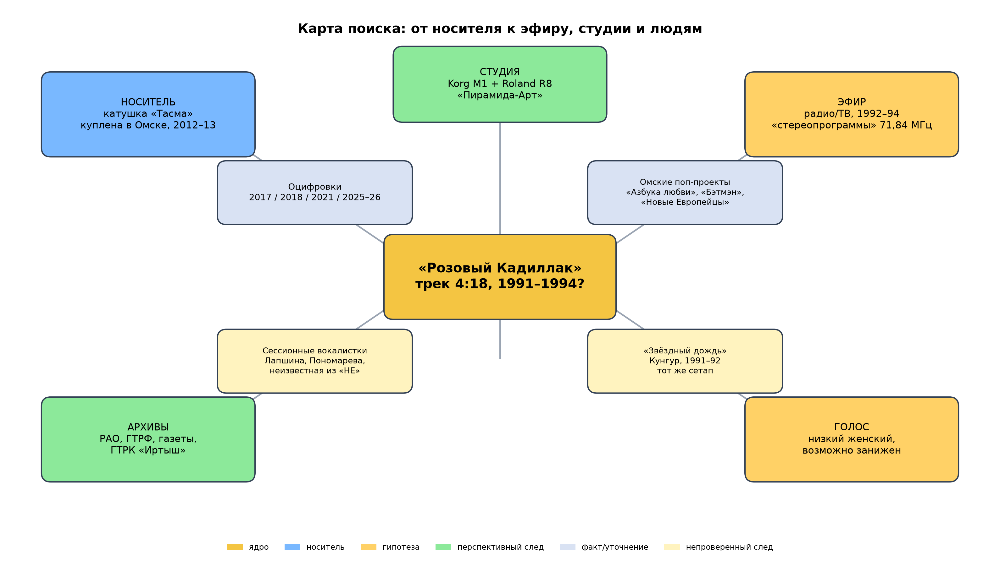

# «Розовый Кадиллак»: дальнейшие направления поиска

**Дата:** 11.11.2026  
**Основание:** анализ 8 553 сообщений чата, аудио и изображений; собственное расследование.  
**Цель:** предложить конкретные, проверяемые шаги, а не очередной список «похожих певиц».

*Детальная версия карты — в файле `graph_rk.png`.*

---

## 1. Ранжирование гипотез

### Гипотеза A. Локальная студийная запись в Омске, 1992–1994 (вероятность ~50%)

**Суть:** песня записана в Омске или области на студии уровня «Пирамида-Арт»/Омского Дома Радио, с сессионной или начинающей певицей; прозвучала один-два раза в региональном эфире; коммерческого релиза не было.

**За:**
- катушка куплена в Омске;
- в треклисте много песен, которые могли звучать в омском эфире;
- в Омске была студия «Пирамида-Арт» с нужным оборудованием;
- у ГТРК «Иртыш» были «стереопрограммы» 71,84 МГц;
- стиль и инструменты соответствуют 1992–1994;
- нет следов в РАО/ГТРФ/Discogs — типично для локального демо.

**Против:**
- катушка могла приехать из другого региона;
- «Пирамида-Арт» больше известна роком/поп-роком, чем евробитом;
- нет прямых документов.

**Что проверить:**
- список сессий «Пирамида-Арт» 1992–1995;
- музыкальные редакторы ГТРК «Иртыш»;
- программы передач омского радио/ТВ;
- сессионные вокалистки омских студий.

### Гипотеза B. Другой регион/республика, копия на катушке (вероятность ~25%)

**Суть:** запись сделана в Кунгуре/Перми («Звёздный дождь»), Беларуси, Украине, Казахстане или Прибалтике; на омскую катушку попала через перезапись/поездку/родственников.

**За:**
- «Звёздный дождь» имеет тот же сетап M1/R8 и похожий вокал при замедлении;
- катушка — личный сборник, могла приехать;
- в чате есть свидетели, слышавшие песню в Тверской области и в Омске;
- акцент певицы некоторым кажется украинским/приднестровским.

**Против:**
- нет документов;
- «Тирас» — вероятный фейк;
- «Блонди Бэнд» опровергнута.

**Что проверить:**
- «Звёздный дождь»: оставшиеся участники, архивы, минусовки;
- белорусские/украинские радио- и ТВ-архивы 1992–1994;
- казахстанские студии и русскоязычная эстрада;
- Прибалтика: не только «Блонди Бэнд».

### Гипотеза C. Демо для конкурса/радио, Москва или другой город (вероятность ~15%)

**Суть:** песня писалась как конкурсная/демо-запись для «Утренней звезды», «Музыкального кафедрала», «Ялты» или радиопрограммы; певица не стала звездой.

**За:**
- профессиональная аранжировка при слабом мастеринге;
- нет релиза;
- текст простой, «конкурсный»;
- в 1992–1994 было много конкурсов и демо-кассет.

**Против:**
- нет аплодисментов/заставки;
- нет документов.

**Что проверить:**
- архивы конкурсов 1991–1995;
- заявки/кассеты конкурсантов;
- «Музыкальный кафедрал», «Утренняя звезда», «Ялта», «Юрмала»;
- статьи о молодых певицах 1992–1994 (пример — Калина Найс).

### Гипотеза D. Известная певица под псевдонимом/ранняя запись (вероятность ~7%)

**Суть:** это ранняя/пробная запись будущей звезды, под псевдонимом или без атрибуции.

**За:**
- голос похож на некоторых известных певиц;
- профессиональная школа слышна.

**Против:**
- почти все проверенные звёзды ответили отрицательно;
- у известной певицы был бы след в дискографии.

**Что проверить:**
- ранние записи Натальи Симоновой, Виктории Виты, Натальи Скурыхиной;
- малоизвестные псевдонимы;
- каталоги студий 1991–1994.

### Гипотеза E. Русская переработка западного хита (вероятность ~3%)

**Суть:** «Розовый Кадиллак» — русская версия «Pink Cadillac» (Springsteen/Natalie Cole) или другой песни про кадиллак.

**За:**
- название и тема совпадают;
- в 1990-е часто делали русские каверы.

**Против:**
- мелодия/гармония, по предварительной оценке, не совпадает;
- текст оригинальный.

**Что проверить:**
- сравнить мелодию/гармонию с «Pink Cadillac»;
- поискать русские каверы 1988–1994;
- проверить авторов перевода.

---

## 2. Граф: что с чем связано

См. изображение `graph_rk.png`. Основные узлы:

- **Ядро:** «Розовый Кадиллак» (трек, 4:18).
- **Носитель:** катушка «Тасма» → покупка в Омске → оцифровки.
- **Эфир:** радиозапись → «стереопрограммы» 71,84 МГц → ГТРК «Иртыш»; альтернатива — ТВ.
- **Студия:** Korg M1 + Roland R8 → «Пирамида-Арт» → люди/проекты.
- **Голос:** низкий женский → сессионная/начинающая певица.
- **Архивы:** РАО/ГТРФ (отрицательно), газеты/ГТРК (перспективно).
- **Сообщество:** 8,5 тыс. сообщений → 50–60 кандидатов → фейки/ИИ.

Красные узлы — отрицательные результаты/фейки; зелёные — перспективные следы; жёлтые — гипотезы; синие — факты.

---

## 3. Направление 1: омская инфраструктура

### 3.1. ГТРК «Иртыш»

**Что искать:**
- музыкальные редакторы 1991–1994;
- сетка «стереопрограмм» на 71,84 МГц;
- программы передач в газетах;
- фонд записей;
- имена ведущих и звукорежиссёров.

**Контакты/точки входа:**
- Владимир Погодаев (ветеран, главный режиссёр до 2023, ведущий «Нехорошо забытое старое»);
- архив ГТРК «Иртыш»;
- сайт `vesti-omsk.ru`;
- омские журналисты, писавшие о радио.

**Важно:** Погодаев уже опросил нескольких знакомых музредов и Алексея Гализдру — никто песню не знает. Но **официального запроса в архив ГТРК не было**. Это не закрытая дверь, а непроверенная. Нужен отдельный письменный/телефонный запрос именно в архив, с точными датами и описанием трека.

**Запрос:**
> «Ищу фонограмму/программу 1992–1994 годов, в которой могла звучать русскоязычная песня „Розовый Кадиллак“ (женский вокал, Korg M1/R8). Нужны программы передач, имена музыкальных редакторов и любые записи стереопрограмм 71,84 МГц. Готов оплатить оцифровку/работу архива».

### 3.2. «Пирамида-Арт»

**Что искать:**
- список сессий 1992–1995;
- сессионные певицы;
- проекты «Азбука любви», «Бэтмэн», «Новые Европейцы», «Воланд», «Мамочка»;
- контакты Ивана Белоусова, Олега/Игоря Фауста, Тимура Тимбаева.

**Контакты/точки входа:**
- Иван Белоусов (руководитель, соцсети/телефон);
- Андрей Картавцев (сайт `andreykartavcev.ru`, соцсети);
- Тимур Тимбаев;
- Олег Фауст;
- Алексей Гализдра (группа «Мамочка», связанная с Белоусовым) — его уже спрашивали о песне; повторно не дергать, только если появится новый конкретный вопрос о сессионных певицах;
- Михаил Немизанский, Сергей Кутейников, Дмитрий Магонов, Вадим Алыпов;
- Discogs label 2925131.

**Запрос:**
> «Ищу любые сведения о сессионных вокалистках и поп-проектах студии „Пирамида-Арт“ 1992–1995. Конкретно интересует песня „Розовый Кадиллак“ (женский низкий вокал, Korg M1/R8). Могли ли её записать у вас? Кто из певиц работал на сессиях? Сохранились ли списки/кассеты?»

Если Белоусову уже писали и он не ответил — не дублировать одно и то же. Лучше искать другого сотрудника студии (Фауст, Тимбаев, Гализдра) или официальный канал «Пирамида-Арт».

### 3.3. Омский Дом Радио

**Что искать:**
- студии, работавшие в здании;
- звукорежиссёры;
- архивы радиопрограмм;
- пересечения с ГТРК.

### 3.4. Омские поп-проекты

Составить таблицу:

| Проект | Годы | Кто пел | Где записан | Проверено? |
|---|---|---|---|---|
| «Нежный возраст» | 1987–1991 | Андрей Картавцев | Омск | нет |
| «Азбука любви» | 1993–1995 | Картавцев + неизвестная певица | «Пирамида-Арт» | нет |
| «Бэтмэн» | 1992–1995 | Андрей Березин, Юлия Лапшина (бэк) | «Пирамида-Арт»/«Мастер» | нет |
| «Новые Европейцы» | 1991–1993 | Куприянов, затем неизвестная певица, затем Алыпов | Омское радио/«Пирамида» | низкий приоритет: драйвовый рок, не синти-поп |
| «Парадный вход» | 1992–1995 | Бочкарев, М. Пономарева (бэк) | «Мастер»/«Пирамида-Арт» | низкий приоритет: тяжёлый рок |
| «Мамочка» | 1990-е | ? | «Пирамида-Арт» | нет |
| «Воланд» | 1993–1995 | Головин | «Пирамида-Арт» | нет |

**Приоритет:** «Азбука любви» (женская вторая вокалистка), «Бэтмэн» (Лапшина). «Новые Европейцы» и «Парадный вход»/Пономарева — низкий приоритет: по альбомам это драйвовый/тяжёлый рок, а не синти-поп/диско.

### 3.5. Московские частные студии (новая линия из чата 11.11.2026)

- **«Студия Ника»** Ирины Мальгиной и её мужа. По словам участницы чата, студия сгорела в 1996 году, многие записи утеряны; муж также продюсировал «МГК». Проверить сохранившиеся каталоги, интервью и упоминания сессий начала 1990-х.
- **Студия Александра Кальянова.** По сообщению в чате, студий было несколько; сохранился веб-архив `studio.kalianov.ru`. Звукорежиссёром был его сын, но неизвестно, работал ли он в начале 1990-х. Проверить архив сайта и Discogs (в чате упомянут `discogs.com/ru/artist/3490502`, но там релизы с 1999 года).
- **Менеджерский след Ирины Ежовой / «Кристиана Рувье»** — в чате признан тупиком; персональные данные не сохранять, повторно не отрабатывать.

---

## 4. Направление 2: архивы и пресса

### 4.1. Газеты

- «Омская правда» (1991–1995).
- «Вечерний Омск» (1991–1995).
- «Молодой сибиряк».
- «TV 11 плюс».
- «Четверг».
- «Коммерческие вести» (с 1991).

**Что искать:**
- «Розовый кадиллак», «Кадиллак», «Пинк Кадиллак»;
- «Пирамида-Арт», «Пирамида»;
- «стереопрограммы», «71,84»;
- имена певиц, конкурсы, дебюты;
- объявления студий звукозаписи.

**Как:**
- оцифрованные подшивки в Омской библиотеке им. Пушкина;
- Исторический архив Омской области (фонд П-9647, «Вечерний Омск»);
- OCR-поиск по PDF (как это делал один из исследователей для екатеринбургских газет);
- запросы в редакции.

### 4.2. Программы передач

- сетка ГТРК «Иртыш»;
- «Радио-3» (с осени 1994);
- «Маяк»/стереопрограммы;
- омское ТВ (12 канал, «Зодиак», «Дебют», «ВКО»);
- музыкальные передачи.

**Что искать:**
- даты трансляций альбомов/сборников;
- названия программ;
- имена ведущих;
- анонсы конкурсов/премьер.

### 4.3. ГТРФ, РАО, ВААП

- ГТРФ: официальный запрос по фонограммам 1991–1994.
- **РГАФД** (с 2024 в составе РГАКФФД): фонд Гостелерадио, читальный зал `zalfono@rgakffd.ru`.
- РАО: поиск по названию/автору, запрос письменного ответа.
- ВААП (до 1993): архивы регистрации.
- РП-Юнион: реестр.
- Украинский/белорусский/казахстанский реестры.
- **Реестр наследственных дел** — если появится ФИО, проверить, жива ли певица.

### 4.4. Библиотеки и музеи

- Омская библиотека им. Пушкина (краеведение, периодика).
- Исторический архив Омской области.
- Музей Омского радио/ТВ (если есть).
- Личные архивы журналистов и музыкантов.

---

## 5. Направление 3: люди

### 5.1. Приоритетный список

1. **Иван Белоусов** — «Пирамида-Арт».
2. **Владимир Погодаев** — ГТРК «Иртыш».
3. **Андрей Картавцев** — «Азбука любви», «Нежный возраст». Писали в 09.2025, ответа нет: сообщение принял администратор.
4. **Тимур Тимбаев** — гитара/драм-машина, омские студии.
5. **Олег Фауст** — звукорежиссёр.
6. **Алексей Гализдра** — «Мамочка», круг Белоусова; уже слышал о песне. Повторно не дергать, только если появится новый конкретный вопрос о сессионных певицах.
7. **Михаил Немизанский** — «Новые Европейцы».
8. **Сергей Кутейников** — «Новые Европейцы».
9. **Дмитрий Магонов** — «Новые Европейцы»/Köln.
10. **Вадим Алыпов** — вокалист «Новых Европейцев» 1993–1994.
11. **Юлия Лапшина** — бэк-вокал «Бэтмэна».
12. **М. Пономарева** — бэк-вокал «Парадного входа» (низкий приоритет: тяжёлый рок группы).
13. **Игорь Чухнин** — «Звёздный дождь».
14. **Павел Фадеев** — «Антикварный магазин».
15. **Сергей Иванов** — «Звёздный дождь».
16. **Наталья Некрасова, Лилия Таламина** — «Звёздный дождь».
17. **Сергей Мудров** — автор песен Воронцовой.
18. **Алексей Колмогоров** — режиссёр «Золотой луны».
19. **Олег Малышков** — Радио-3.
20. **Диджеи «Карибу»** — уже опрошены, но можно перепроверить.
21. **Семьи умерших кандидатов** — Журкина, Воронцова, Петросова, Лагутенкова.
22. **Двое локальных участников** — Павел Зиновьев и вторая участница из Омска (в этом топике не отмечалась). Распределить между ними омские библиотеки/архивы, чтобы не дублировать.

### 5.2. Как обращаться

- Кратко: кто вы, зачем, что нашли, что просите.
- Приложить аудио (4:18) и 1–2 факта.
- Не давить, не спамить, не обещать сенсацию.
- Уважать отказ; просить контакт коллеги, если человек не помнит.
- Для пожилых — через родственников/знакомых, не напрямую.

### 5.3. Что спрашивать

- «Знали ли вы кого-то, кто пел в омских студиях в 1992–1995?»
- «Кто делал минусовки на Korg M1/R8?»
- «Были ли сессионные певицы, которых не указывали в credits?»
- «Сохранились ли кассеты/списки сессий?»
- «Могли ли песню записать у вас?»
- «Кто из омских радио/ТВ людей мог ставить такие записи?»

---

## 6. Направление 4: форензика

### 6.1. Калибровка

**Статус: выполнено, см. `11_Калибровка_скорости`.**

- Использованы шесть CD-референсов: Агутин, Буланова, Аллегрова, «Миражи», Кай Метов.
- Катушка не имеет одной скорости: медленный префикс (+1,1–1,3%), быстрый остров (+5–6%) и медленный суффикс (+1,5–2%).
- «Кадиллак» — в быстром блоке, оценка **+5,5%**; готовый файл `Розовый_Кадиллак_CD-speed_r1055.mp3` (playback rate 0,948).
- Все сравнения тембра и вокала делать только по калиброванному файлу.
- `РК 2017.mp3` **не использовать** для калибровки, сравнения тембра или выводов о линии 15,7 кГц: это запись на диктофон дешевого телефона через микрофон, с неизвестного магнитофона. Только дата/контекст.
- Проверить, нет ли на файле 2017 года лишних секунд до/после песни (речь, джингл, предыдущий трек) — но не делать по нему выводов о скорости/АЧХ.

### 6.2. Вокал

1. Demucs → vocals.wav.
2. Очистить от шумов/музыки.
3. Сравнить с кандидатами через speaker embeddings (ECAPA/Resemblyzer).
4. Слепой тест: 10 фрагментов, 2 эксперта, ранжирование.
5. Учитывать артикуляцию, вибрато, произношение, диапазон.

### 6.3. Минус

1. Demucs → no_vocals.wav.
2. Chroma/DTW по корпусу омских/сибирских поп-записей.
3. Искать тот же бас-патч/пиано/драм-паттерн.
4. Сравнить с «Звёздным дождём», «Азбукой любви», «Бэтмэном». «Новые Европейцы» — низкий приоритет по стилю.
5. Разобрать 93-МБ оцифровку «Белый танец / Подойди / Я и ты / Тебе не запретить» (мужской вокал, тот же круг коллекционера): проверить инструменты, шумовой профиль, возможную ту же студию.

### 6.4. Эфир

1. Найти джинглы/позывные/рекламу на катушке.
2. Транскрибировать Whisper.
3. Сопоставить с программами передач.
4. Определить станцию/программу/дату.

### 6.5. 15,7 кГц

1. Измерить амплитуду/фазу/стабильность.
2. Проверить, есть ли сигнал на стороне А/Б, в паузах, в конце.
3. Сравнить с бытовыми CRT/мониторами.
4. Не использовать файл 2017 года для проверки линии: микрофон телефона срезал ВЧ; отсутствие линии там ничего не значит.
5. Сделать вывод по поздним WAV/MP3: источник — локальный прибор или запись.

---

## 7. Направление 5: текст и авторство

1. Поиск строк в OCR-архивах газет 1991–1995.
2. Поиск на stihi.ru, litprichal, стихи.ру.
3. Проверка сборников песен, конкурсных заявок.
4. Сравнение с «Pink Cadillac» и русскими каверами.
5. Поиск автора по характерным строкам («тьму ночи вдаль разгоняет», «где скорость, ветра свист и риск всегда»).
6. Проверка «Талисман»/Арины Поповой в РАО (осторожно: вероятно, не то).
7. Расшифровать «П.п. „Выборочный-4“»: может быть «первая половина», «предыдущая песня» или инициалы; связать с предыдущими записями на катушке.
8. Проверить «Вику Борщенко» (участница «50/50» 1994, кабацкий репертуар) — низкая вероятность, но в основном чате не проверяли.

---

## 8. Направление 6: сообщество и публикация

### 8.1. Что сделать

- Создать единую базу (Notion/Airtable/Google Sheets).
- Опубликовать краткий отчёт и аудио.
- Сделать ролик с No Changes или другим lostwave-блогером.
- Написать краеведческую статью в омские СМИ.
- Сделать страницу на Lostwaves Finest/Reddit.
- Провести AMA/стрим с музыкантами.

### 8.2. Чего не делать

- Не объявлять «солв» без доказательств.
- Не спамить знаменитостей.
- Не публиковать личные данные.
- Не давить на пожилых людей.
- Не использовать ИИ как источник.

---

## 9. План 30/60/90 дней

### Первые 30 дней

- [ ] Калибровка скорости, эталонный WAV.
- [ ] Паспорт катушки: карта треков, шумы, обрывы.
- [ ] Таблица кандидатов (50–60 строк) с доказательствами.
- [ ] Список 30 людей/организаций для обращения.
- [ ] Официальный запрос в архив ГТРК «Иртыш» (не только Погодаеву).
- [ ] Запрос в «Пирамида-Арт»/Белоусову и Гализдре.
- [ ] Поиск программ передач в омских газетах.
- [ ] Подключить двоих локальных участников к омским библиотекам/архивам.
- [ ] Разобрать файл 2017 года и 93-МБ оцифровку.

### 60 дней

- [ ] Интервью с 10–15 музыкантами/журналистами.
- [ ] Проверка «Азбуки любви» и «Бэтмэна»; «Новые Европейцы» — низкий приоритет по стилю.
- [ ] Поиск в архивах ГТРФ/РАО/ВААП/РГАФД.
- [ ] Проверить реестр наследственных дел (если появится ФИО).
- [ ] Сравнение вокала с кандидатами.
- [ ] Публикация промежуточного отчёта.

### 90 дней

- [ ] Проверка «Звёздного дождя» (Кунгур).
- [ ] Проверка белорусского/украинского следа.
- [ ] Краеведческая статья/ролик.
- [ ] Решение: солв или фиксация отрицательного результата.
- [ ] Передача материалов в архив/сообщество.

---

## 10. Метрики успеха

- Найдены новые документы (программы передач, списки сессий, кассеты).
- Установлены имена 5–10 новых людей, которые могли знать певицу.
- Получены 3–5 содержательных ответов (не отписок).
- Сравнение аудио дало формальный результат (ранжирование кандидатов).
- Опубликован проверяемый материал, который дошёл до омской аудитории.

---

## 11. Риски и как их снизить

| Риск | Как снизить |
|---|---|
| Фейк/вброс | Проверять происхождение, не объявлять солв |
| Потеря доверия | Деликатные обращения, извинения за спам |
| Уход в «звёзд» | Сменить класс гипотез, фокус на локальную сцену |
| Потеря данных | Единая база, бэкапы, версионирование |
| Выгорание | Разделить роли, вести документацию |
| Юридические/этические проблемы | Не публиковать личные данные, уважать отказ |

---

## 12. Куда обращаться: краткий справочник

### Омск

- ГТРК «Иртыш» / `vesti-omsk.ru`.
- Омский Дом Радио.
- Студия «Пирамида-Арт» (Иван Белоусов).
- Омская библиотека им. А. С. Пушкина.
- Исторический архив Омской области.
- Редакции «Вечерний Омск», «Омская правда», «Коммерческие вести», «Трамплин», «12 канал».
- Омские музыканты: Картавцев, Тимбаев, Фауст, Немизанский, Кутейников, Магонов, Алыпов, Лапшина, Пономарева, Гализдра.
- Двое локальных участников чата — физический поход в библиотеку/архив.

### Москва/федеральные

- ГТРФ, отдел продаж/архив.
- РАО, реестры.
- ВААП (архив).
- РП-Юнион.
- РГАФД (с 2024 в составе РГАКФФД), читальный зал `zalfono@rgakffd.ru`.
- Реестр наследственных дел.
- Российская государственная библиотека (газеты).
- Музей музыки.

### Международные

- Lostwaves Finest, r/lostwave, WatZatSong, Soulseek.
- Белорусский/украинский/казахстанский реестры.
- Латвийский/литовский/эстонский архивы.
- Русскоязычные диаспоры в Германии/США/Израиле.

---

## 13. Собственные выводы

1. **Песня, скорее всего, не была хитом.** У неё нет следов в дискографиях, РАО, ГТРФ. Это либо демо, либо локальный эфир.
2. **Омск — не просто место покупки.** Совпадение студии, радио и треклиста слишком сильное, чтобы игнорировать.
3. **Самое слабое звено — не голос, а документы.** Мы не знаем, кто работал в студии и что звучало в эфире.
4. **Самое сильное звено — катушка.** Она ещё не исчерпана: карта треков, шумы, обрывы, надписи, другие катушки из партии.
5. **Следующий шаг — не новый кандидат, а новый архив.** Один список сессий «Пирамида-Арт» может дать больше, чем 50 новых имён.
6. **Если ответ найдётся, он, вероятно, будет неожиданным.** Не «звезда», а забытая сессионная певица, которая, возможно, даже не считала это событием.
7. **Файл 2017 года — только свидетельство даты.** Он подтверждает, что песня существовала и была выложена 27.03.2017, но не годится как эталон скорости/АЧХ/линии: записан на микрофон дешевого телефона с неизвестного магнитофона.
8. **Самые дешёвые двери всё ещё открыты:** ГТРК, РГАФД, реестр наследственных дел, двое локальных людей, «П.п. „Выборочный-4“».

---

**Главное:** поиски нужно вести не «по голосу», а «по инфраструктуре». Голос — это ключ, но дверь открывается документами: кто записывал, где, когда и для кого.