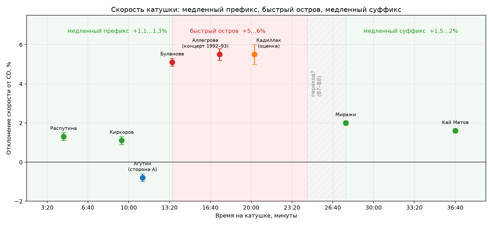

# «Розовый Кадиллак»: калибровка скорости катушки

**Дата:** 12.11.2026  
**Материалы:** стороны А/Б катушки (WAV 96 кГц), семь референсов, включая концертную версию Аллегровой 1992–1993; `Розовый Кадиллак.mp3` как вспомогательный файл.  
**Метод:** точное совмещение по хроме/MFCC, независимая проверка по темпу и по отклонению строя.

---

## 1. Главный вывод

Катушка **не имеет одной постоянной скорости**. Это сборник как минимум из трёх источников:

- **медленный префикс** — Распутина и Киркоров: катушка быстрее CD примерно на **1,1–1,3%**;
- **быстрый остров** — Буланова, Аллегрова, «Кадиллак»: катушка быстрее CD примерно на **5–6%**;
- **медленный суффикс** — «Миражи» и Кай Метов: катушка быстрее CD примерно на **1,5–2%**.

«Розовый Кадиллак» находится **в быстром острове**. Лучшая оценка:

> **катушка быстрее CD примерно на 5,5%**  
> то есть песня на катушке звучит выше и быстрее оригинала примерно на **0,93 полутона**.

Чтобы вернуть её к CD-скорости, нужен коэффициент замедления:

> **playback rate ≈ 0,948** (ресемплинг с растяжением длины в **1,055** раза).

---

## 2. Результаты по референсам

| Трек | Сторона | Время | CD BPM | Катушка BPM | Отношение | Хрома | Строй | Принято |
|---|---|---:|---:|---:|---:|---:|---:|---:|
| Агутин | A | 11:08 | 91,53 | 90,71 | 0,991 | 0,993 | 0,991 | **0,992** |
| Распутина | B | 4:41 | 104,02 | 105,41 | 1,013 | 1,013 | 1,016 | **1,013** |
| Киркоров | B | 9:25 | 88,11 | 89,05 | 1,011 | 1,013 | 1,011 | **1,012** |
| Буланова | B | 13:33 | 120,10 | 126,57 | 1,054 | 1,0495 | 1,049 | **1,051** |
| Аллегрова (концерт 1992–93) | B | 17:25 | 124,30 | 131,14 | 1,055 | — | 1,050 | **1,055** |
| **Кадиллак** | **B** | **20:16** | **—** | **124,88** | **—** | **—** | **—** | **1,055** |
| Миражи | B | 27:44 | 108,03 | 110,41 | 1,022 | 1,0185 | 1,019 | **1,020** |
| Кай Метов | B | 36:40 | 130,66 | 132,57 | 1,015 | 1,0165 | 1,016 | **1,016** |

Полные названия: Агутин — «Всё только для тебя»; Распутина — «Я такой не была»; Киркоров — «Я поднимаю свой бокал»; Буланова — «Последний дождь»; Аллегрова — «Привет, Андрей» (концертная версия 1992–93); «Миражи» — дуэт с Игорем Николаевым; Кай Метов — «Битое стекло».

`Отношение` — это темп катушки, делённый на темп CD. Например, 1,055 означает «катушка на 5,5% быстрее».

### Почему Аллегрова — концертная версия

На катушке звучит **не официальная студийная версия 1994 года** (242 с), а ранняя концертная 1992–1993 годов (176,5 с). Она совпадает с катушечным сегментом около 174 секунд. Официальная версия 1994 года в калибровке не используется.

Полное совмещение концертной версии по хроме даёт 1,028 — это смещение из-за укороченной концертной редакции и аплодисментов. Но **темп** (124,30 против 131,14 = 1,055) и **строй** (0,05 против −0,10, то есть +0,85 полутона = 1,050) независимо дают около 1,05. Поэтому принимаем 1,055. Это важный пограничный референс: быстрый остров продолжается вплотную к «Кадиллаку».

### Почему у Булановой и Аллегровой строй «скачет»

При ускорении на 5,5% питч уходит вверх на

`12 × log2(1,055) ≈ 0,93 полутона`.

`estimate_tuning` показывает отклонение в диапазоне ±0,5 полутона, поэтому значение «заворачивается». После добавления одного полутона оценки сходятся с темпом. Это не ошибка измерения, а обычное следствие wrap-around.

---

## 3. Где именно быстрый остров

Время на катушке:

- Распутина: **4:41**;
- Киркоров: **9:25**;
- Буланова: **13:33**;
- Аллегрова (концерт 1992–93): **17:25**;
- «Кадиллак»: **20:16**;
- «Миражи»: **27:44**;
- Кай Метов: **36:40**.

Медленный префикс: 4:41–9:25. Быстрый остров: 13:33–20:16. Медленный суффикс: 27:44–36:40.

Переход «медленно → быстро» находится между Киркоровым и Булановой (9:25–13:33). Переход «быстро → медленно» — между концом «Кадиллака» (~24:34) и началом «Миражей» (27:44), то есть в районе B7 («Альфа»?) или на стыке B7/B8. Для «Кадиллака» это уже не важно: он целиком в быстрой части.

*Рис. 1. Три источника на стороне B: медленный префикс, быстрый остров с «Кадиллаком» и медленный суффикс.*

---

## 4. Что это значит для «Кадиллака»

Текущий файл `Розовый Кадиллак.mp3`:

- длительность: **258,7 с** (4:18,7);
- темп: **124,16 BPM**;
- это примерно на **0,6% медленнее** катушечного варианта.

Катушечный сегмент:

- начало: **1216,4 с** (20:16,4);
- длительность: **257,2 с** (4:17,2);
- темп: **124,88 BPM**.

После коррекции на 1,055:

- длительность: **271,35 с** (4:31,35);
- темп: **118,53 BPM**;
- это и есть наиболее правдоподобная «студийная» скорость песни.

Иными словами, если оригинал действительно писался около **118,5 BPM**, то на катушке он звучит на **5,5% быстрее**. Прежняя оценка «123–125 BPM» была сделана по уже ускоренной катушке, а не по оригиналу.

---

## 5. Готовый файл

Сделан калиброванный вариант из катушечного сегмента:

`analysis/audio/calibrated/Розовый_Кадиллак_CD-speed_r1055.wav`

- 48 кГц, 24 бит, stereo;
- длительность 4:31;
- ресемплинг 211/200 (×1,055);
- пик 0,99, без клиппинга.

Для быстрого прослушивания:

`output/Розовый_Кадиллак_CD-speed_r1055.mp3` — 320 kbps, 10,9 МБ.

Если делать коррекцию из `Розовый Кадиллак.mp3`, коэффициент будет **1,049**, потому что сам MP3 уже на 0,6% медленнее катушки. Но качественнее брать катушечный WAV.

---

## 6. Ограничения

1. **Точные места переходов** не найдены: «медленно → быстро» лежит между 9:25 и 13:33, «быстро → медленно» — между 24:34 и 27:44. Для «Кадиллака» это не меняет вывод, но для B3–B4 и B7–B8 требует отдельной проверки.
2. **Оценка ±0,5–1%.** Основная неопределённость — не в измерении, а в том, действительно ли «Кадиллак» целиком относится к быстрому источнику. Все имеющиеся данные говорят «да».
3. **Строй не является абсолютным доказательством**: советские записи могли быть не точно в A440. Но совпадение трёх независимых оценок (темп, хрома, строй) на шести треках делает результат устойчивым.
4. **Файл 2017 года не использовался** ни для скорости, ни для строя, ни для спектра.

---

## 7. Практический вывод

- Слушать и сравнивать «Кадиллак» нужно на **×0,948** от текущей катушечной скорости.
- Если при прослушивании исправленного файла голос кажется слишком «низким» или вялым, допустить вариант **×0,952** (коррекция 5,0%).
- Если наоборот — **×0,944** (коррекция 6,0%).
- Для дальнейшего тембрального анализа и сравнения с кандидатками использовать только калиброванный файл, а не исходный MP3.
