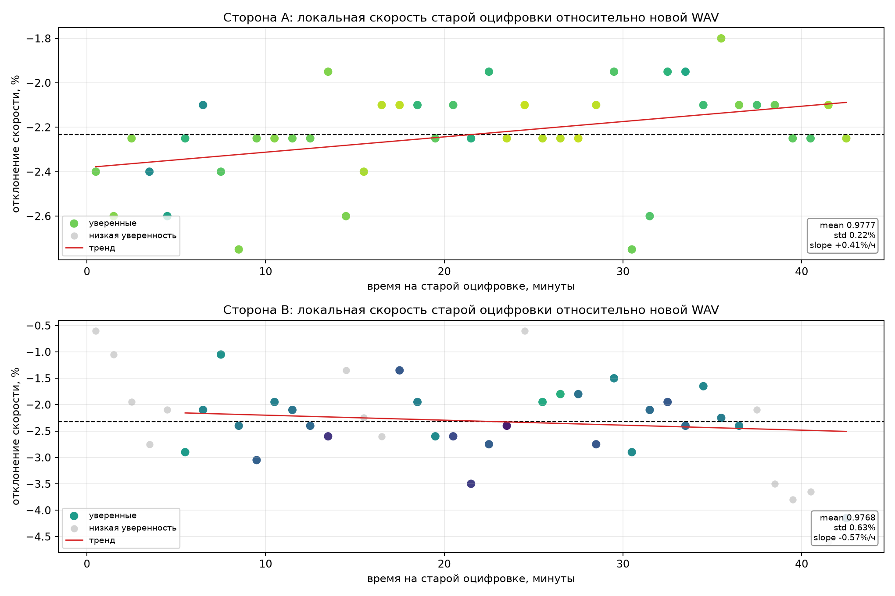
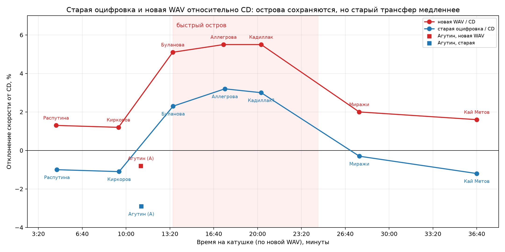

# Старая оцифровка катушки: насколько плывёт скорость

**Дата:** 12.11.2026  
**Материалы:** старые почищенные оцифровки `Розовый_Кадиллак_Сторона_1_Оцифровка.mp3` и `..._Сторона_2_Оцифровка.mp3`; новые WAV 96 кГц.  
**Метод:** глобальное совмещение по хроме, затем локальные окна по 60 секунд с независимым поиском коэффициента скорости.

---

## 1. Короткий ответ

Старая оцифровка — **не «плывущая» запись с большим wow**, а просто **более медленный трансфер** той же катушки:

- сторона A: старая оцифровка медленнее новой WAV примерно на **2,2%**;
- сторона B: медленнее примерно на **2,3%**;
- локальная скорость внутри стороны A стабильна: разброс около **±0,2%** (≈ ±3,7 цента);
- на стороне B разброс больше: около **±0,6%** (≈ ±11 центов), плюс возможный медленный дрейф порядка **−0,6%/час**;
- в самом конце стороны B (после ~38 минут) несколько точек выпадают сильнее, но там низкая уверенность совмещения — это скорее другой фрагмент/стык, чем реальное «плавание».

Для сравнения: глобальные −2,2…−2,3% — это примерно **−39…−41 цент**.

---

## 2. Глобальное совмещение

| Старая сторона | Новая сторона | Коэффициент (старая / новая) | Смещение | Уверенность |
|---|---|---:|---:|---:|
| Сторона 1 | Сторона A | **0,9760** | 0,0 с | 0,943 |
| Сторона 2 | Сторона B | **0,9740** | 4,8 с | 0,877 |

То есть старая оцифровка — это та же катушка, но с другой скоростью протяжки/оцифровки. Разница в длительности (2680 против 2616 с) почти полностью объясняется этим коэффициентом.

---

## 3. Локальный дрейф

Окна по 60 секунд, коэффициент искался независимо в каждом окне.

| Сторона | Средний коэффициент | Разброс (1σ) | Линейный дрейф | Остаточный разброс |
|---|---:|---:|---:|---:|
| A | 0,9777 | **0,22%** | **+0,4%/час** | 0,20% |
| B (только уверенные точки) | 0,9768 | **0,63%** | **−0,6%/час** | 0,62% |

### Сторона A

Практически ровная линия: локальная скорость гуляет в пределах ±0,2%. Для слуха это очень мало; на тембральное сравнение почти не влияет.

### Сторона B

Разброс заметнее, но это всё ещё десятые доли процента, а не «плывущая кассета». Основные точки лежат в диапазоне 0,965–0,986. Ближе к концу стороны есть несколько низкоуверенных окон с 0,954–0,962; их лучше не использовать для выводов о дрейфе.

---

## 4. Что это значит практически

1. **Для прослушивания** старую оцифровку можно использовать, но она будет звучать ниже и медленнее новой WAV примерно на 2,2–2,3%.
2. **Для тембрального сравнения** её нужно привести к новой WAV: растянуть/ускорить с коэффициентом около **1,023–1,024** (или ресемплингом 1/0,976).
3. **Для абсолютной калибровки скорости** лучше оставаться на новой WAV: у старой оцифровки есть собственный постоянный сдвиг и небольшой локальный дрейф.
4. **«Кадиллак»** на старой оцифровке находится в том же быстром острове, но из-за общего замедления он там примерно на 2,4% медленнее новой WAV. Если считать от CD, старая версия «Кадиллака» должна быть примерно на **+3%** быстрее CD, а не на +5,5%. Поэтому для финального сравнения и калибровки используем новый WAV/уже готовый `Розовый_Кадиллак_CD-speed_r1055.mp3`.

---

## 5. График

*Рис. 1. Вверху — сторона A: ровная скорость. Внизу — сторона B: разброс больше, но в основном в пределах ±0,6%; крайние точки после 38 минут — низкоуверенные.*

---

## 6. Вывод

Старая оцифровка **не является эталоном скорости**, но и не «плывёт» катастрофически:

- постоянный сдвиг: **−2,2…−2,3%**;
- wow/дрейф: **0,2%** на стороне A и **0,6–0,8%** на стороне B;
- для спектральных и тембральных сравнений её можно использовать после приведения к новой WAV;
- для выводов о скорости «Кадиллака» — только новый WAV и калиброванный файл.

---

## 7. Сравнение с CD-оригиналами

Проверил старую оцифровку напрямую по тем же CD-референсам. Результат: **острова не исчезли**, но вся кривая старой оцифровки лежит примерно на **2,3–2,4% ниже** новой WAV.

| Трек | Старая оцифровка / CD | Новая WAV / CD | Разница |
|---|---:|---:|---:|
| Агутин (сторона A) | **0,971** (−2,9%) | 0,992 (−0,8%) | −2,1% |
| Распутина | **0,990** (−1,0%) | 1,013 (+1,3%) | −2,3% |
| Киркоров | **0,989** (−1,1%) | 1,012 (+1,2%) | −2,3% |
| Буланова | **1,023** (+2,3%) | 1,051 (+5,1%) | −2,8% |
| Аллегрова (концерт 1992–93) | **1,032** (+3,2%) | 1,055 (+5,5%) | −2,3% |
| «Кадиллак» (оценка) | **~1,030** (+3,0%) | 1,055 (+5,5%) | −2,5% |
| Миражи | **0,997** (−0,3%) | 1,020 (+2,0%) | −2,3% |
| Кай Метов | **0,988** (−1,2%) | 1,016 (+1,6%) | −2,8% |

То есть старая оцифровка **ближе к CD по абсолютной скорости**, чем новая WAV, но **не выравнивает** катушку: быстрый остров Буланова–Аллегрова–«Кадиллак» остаётся на уровне **+2,3…+3,2%**, просто он стал ниже на те же ~2,3%.

### Почему так

Это ровно то, что должно получиться, если старая оцифровка — **равномерно более медленный трансфер той же катушки**:

`старая / CD ≈ (старая / новая) × (новая / CD) ≈ 0,976 × (новая / CD)`.

Для Булановой: `0,976 × 1,051 ≈ 1,026` — измерено 1,023.  
Для Аллегровой: `0,976 × 1,055 ≈ 1,030` — измерено 1,032.  
Для Миражей: `0,976 × 1,020 ≈ 0,996` — измерено 0,997.  
Для Кая Метова: `0,976 × 1,016 ≈ 0,992` — измерено 0,988.

Совпадение хорошее. Значит, «острова» — свойство самой катушки/её источников, а не артефакт новой оцифровки.

*Рис. 2. Красная кривая — новая WAV, синяя — старая оцифровка. Форма одинаковая, но старая сдвинута вниз примерно на 2,3–2,4%.*

### Практический вывод

- Для **абсолютной скорости** старая оцифровка ближе к CD, но всё равно требует **по-трековой** коррекции: от −2,9% (Агутин) до +3,2% (Аллегрова). Единого коэффициента для всей стороны нет.
- Для **«Кадиллака»** старая оцифровка даёт примерно **+3,0%** к CD. Если делать коррекцию из неё, нужно замедлить примерно на **2,9%** (playback rate ≈ 0,971), а не на 5,5%.
- Но поскольку новая WAV уже откалибрована и из неё сделан готовый файл, для финальных сравнений удобнее `Розовый_Кадиллак_CD-speed_r1055.mp3`.
- Старую оцифровку лучше использовать как **второй независимый взгляд** на те же острова: она подтверждает, что быстрый участок — не случайность новой оцифровки.
