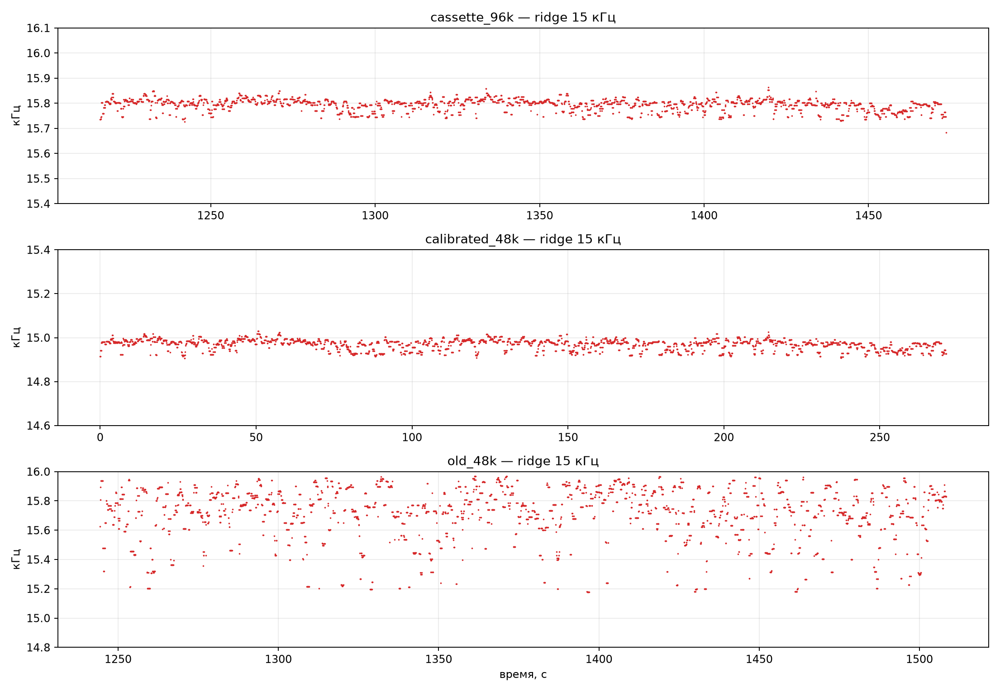
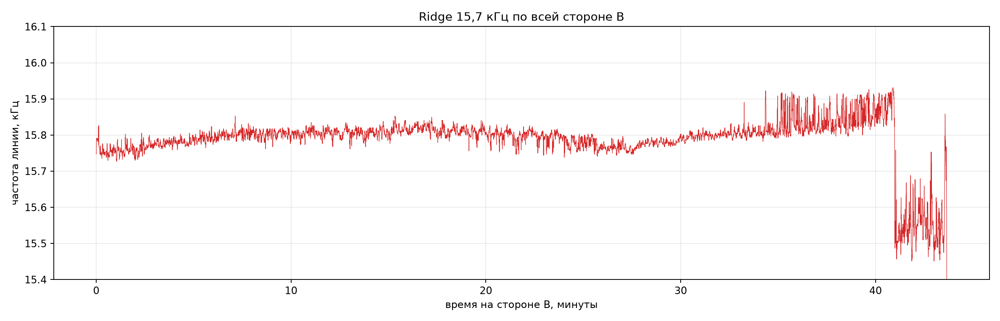

# «Розовый Кадиллак»: помеха в районе 15 кГц

**Дата:** 12.11.2026  
**Материалы:** новый WAV 96 кГц, калиброванный `Розовый_Кадиллак_CD-speed_r1055.wav`, старая почищенная оцифровка, полная сторона B.  
**Метод:** STFT с высоким разрешением по частоте, отслеживание узкополосного пика (ridge) в диапазоне 15,4–16,1 кГц, пересчёт в центы.

---

## 1. Короткий ответ

На калиброванной версии «Кадиллака» линия находится на **14,97 кГц**. На исходной катушке — на **15,80 кГц**. Отношение:

`15 799,8 / 14 973,6 = 1,0552`

Это ровно тот коэффициент, которым мы замедляли катушку. Значит, линия **масштабируется вместе со скоростью** и сидит в самом аудио, а не появляется в плеере после ресемплинга.

Линия очень стабильна:

- на катушке: **15 799,8 Гц**, σ = **23,7 Гц** (≈ **2,6 цента**);
- после калибровки: **14 973,6 Гц**, σ = **23,6 Гц** (≈ **2,7 цента**).

То есть это не «плавающая» помеха, а довольно стабильный узкополосный тон.

---

## 2. Измерения

| Файл / сегмент | Медиана линии | σ, Гц | σ, центов | Комментарий |
|---|---:|---:|---:|---|
| Катушка, «Кадиллак» (20:16–24:34) | **15 799,8 Гц** | 23,7 | 2,59 | чистый устойчивый ridge |
| Калиброванный «Кадиллак» (×1,055) | **14 973,6 Гц** | 23,6 | 2,74 | ожидалось 14 976,1 Гц; совпадение в пределах 2,5 Гц |
| Старая оцифровка, «Кадиллак» | 15 748,5 Гц | 182,4 | 20,23 | ridge рваный, 15,2–16,0 кГц; для выводов не годится |
| Новая WAV, вся сторона B | 15 796,9 Гц | 86,6 | 9,53 | линия есть во всех кадрах, но дрейфует |

### По блокам стороны B

| Участок | Медиана линии | σ, Гц | σ, центов |
|---|---:|---:|---:|
| Префикс, 0–13:33 | 15 791,0 Гц | 47,9 | 5,25 |
| Быстрый остров, 13:33–24:35 | 15 805,7 Гц | 48,1 | 5,27 |
| Переход, 24:35–27:44 | 15 764,6 Гц | 41,8 | 4,58 |
| Суффикс, 27:44–40:40 | 15 805,7 Гц | 65,8 | 7,19 |
| Хвост, 40:40–конец | 15 568,4 Гц | 199,3 | 21,97 |

---

## 3. Что это значит

### 3.1. Линия не является пилотом радиостанции

Если бы это был пилот или строчная частота телевизора **из источника**, при переходе к быстрому острову она должна была бы прыгнуть вместе с музыкой на те же **+5–6%**, то есть примерно на **+0,8–0,9 кГц**. Этого нет: по блокам линия гуляет всего на **±0,1–0,2 кГц** (десятые доли процента).

Вывод: линия не привязана к скорости исходных записей. Скорее всего, это **наводка от CRT/монитора, записанная при перезаписи/сведении на саму катушку** (или при оцифровке), а не маркер эфира.

### 3.2. Линия подтверждает калибровку

Тот факт, что после ×1,055 линия ушла с 15 799,8 на 14 973,6 Гц, — хорошая независимая проверка коэффициента. Если бы мы ошиблись в скорости, линия ушла бы не туда. Совпадение с ожидаемыми 14 976,1 Гц — в пределах 2,5 Гц.

### 3.3. Старая оцифровка для ВЧ-анализа не годится

В старой почищенной оцифровке ridge рваный: 15,2–16,0 кГц, σ = 20 центов. Там либо сработало шумоподавление/кодек, либо линия другого происхождения. Для анализа 15 кГц нужно использовать новый WAV 96 кГц, а не старый MP3.

### 3.4. Полная сторона B

Линия присутствует на всей стороне, но медленно дрейфует: в начале около 15,79, на быстром острове 15,81, к концу — 15,80, а после 40 минут начинает падать и шуметь (15,5–15,6). Это может быть связано с концом катушки/ухудшением контакта, а не с музыкой. Для калибровки «Кадиллака» этот участок не используется.

---

## 4. Графики

*Рис. 1. Сверху — катушка: ровная линия 15,80 кГц. В центре — калиброванная версия: та же линия на 14,97 кГц. Снизу — старая оцифровка: ridge рваный, для измерений не годится.*

*Рис. 2. Линия по всей стороне B. Видно, что она не прыгает на границах «быстрого острова», а медленно дрейфует.*

---

## 5. Какие ещё автоматизированные проверки можно сделать

### Уже можно запускать

1. **Ridge 15,7 кГц по стороне A** — проверить, есть ли там та же линия и насколько стабилен транспорт.
2. **50/100 Гц hum** — если в записи есть сетевая наводка, её гармоники дадут второй независимый пилот скорости.
3. **Детектор стыков/склеек** — spectral flux, скачки уровня, стереофаза, изменение шумового пола. Это покажет точные границы «медленный префикс / быстрый остров / медленный суффикс».
4. **Кластеризация шумового пола и комнатного тона** — сгруппировать треки по источникам: радиоэфир, другая катушка, домашняя перезапись.
5. **Проверка кодеков и обработки** — спектральный срез MP3, следы денойза, upsampling, клиппинг, DC. Это уже видно по старой оцифровке.
6. **Поиск копий по шумовому отпечатку** — сравнение помех/детонации, чтобы отличать независимую запись от повторной оцифровки (как было с «магаданской» катушкой).

### Требуют дополнительных данных или ручной валидации

7. **Korg M1 / Roland R8 preset matching** — сравнить спектральные шаблоны пиано, баса, струнных и drum-паттерны с известными демо M1/R8.
8. **Speaker embeddings** — ECAPA/Resemblyzer по вокалу против кандидаток; нужен корпус их записей.
9. **ASR/фонетический поиск** — распознать текст и искать редкие фразы, но для пения точность ограничена.
10. **Детектор радио/ТВ-маркеров** — 19 кГц пилот, 57 кГц RDS, TV sync buzz, джинглы. По текущей линии уже видно, что 15,7 кГц — не пилот.
11. **Анализ метаданных и происхождения файлов** — MP3-заголовки, encoder delay, история sample rate, хеши, даты.

---

## 6. Вывод

- 15,7 кГц — **реальная узкополосная помеха в аудио**, стабильная, с σ около **2,6 цента**.
- После калибровки она уходит на **14,97 кГц**, ровно как должна при ×1,055.
- Это **не пилот радиостанции** и не маркер источника: на границах быстрого острова линия не прыгает.
- Скорее всего, это наводка от CRT/монитора, записанная при перезаписи/оцифровке; для идентификации станции она бесполезна.
- Для дальнейшей ВЧ-форензики использовать только новый WAV 96 кГц; старая почищенная оцифровка линию не сохраняет.
